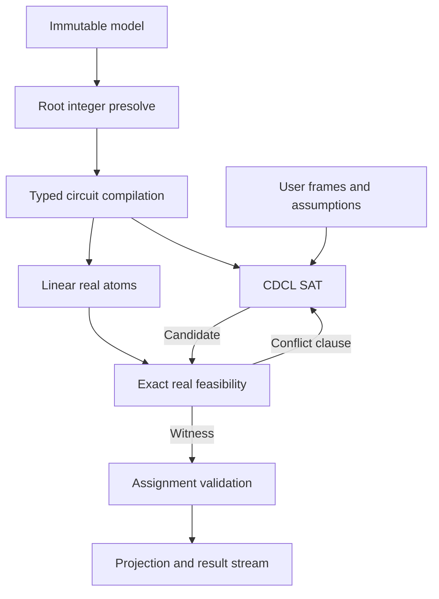

# Pure Kotlin backend design

## Scope and delivery

The new `:solve-kotlin` module supplies `KotlinBackend` and `KotlinConfiguration`, with route ID `kotlin/direct`.
Its first implementation targets every built-in node in the existing Boolean, finite-integer, linear-real and
bit-vector IR. The public modelling and solving interfaces remain unchanged. A project dependency is enough
to use the backend from a source checkout.

The source is an original implementation of standard SAT/circuit and exact linear-elimination techniques.
No Gurobi binary, disassembly or proprietary implementation was used. Compatibility is defined by this
repository's semantics and contracts. The much larger union of all external solvers' features remains a
staged extension of the IR and engine, not a property of this first backend.

This is an implementation branch with test-first commit ordering. Its suites now compile and pass on the JVM,
Node and Linux Native; performance is measured below. [The validation record](PURE-KOTLIN-VALIDATION.md) distinguishes source inspection
from execution. Publication remains gated.

## Architecture

`KotlinSolver` owns independent streams and sessions through the existing managed lifecycle classes.
`KotlinEngine` owns one SAT database, one translator and its compiled atoms. The model owns no mutable solver
state. All production code is portable common Kotlin; JVM-only timing code is a manual test-source harness.

### Finite arithmetic

An `IntegerEncoding` stores signed two's-complement SAT literals and conservative exact minimum/maximum
values. Those bounds determine enough bits for each operation. Products use exact endpoint bounds; negative
products, negation and narrowing sums retain their mathematical values. There is no machine-integer
overflow in model arithmetic.

An integer variable is compiled from an unsigned offset over `0..(max-min)` and its exact lower bound.
Consequently a tiny domain near `2^80` requires only a few independent Boolean decisions. A domain union adds
explicit interval membership, without enumerating every value. Its decoded value is checked against the
original domain by the assignment factory.

Bit-vectors share the Boolean primitives but retain their separate fixed-width semantics: modular arithmetic,
saturating variable shifts and explicit signed/unsigned interpretation. Shift amounts are never truncated to
machine integers. Size limits are checked before allocating arithmetic outputs.

Boolean gates are fully reified with Tseitin-style clauses. Arithmetic comparisons, cardinalities, pairwise
all-different, allowed tuples and element selection can therefore appear under arbitrary Boolean connectives.
The support report exposes each global decomposition. Structural globals (inverse, circuit, subcircuit,
cumulative, regular, bin packing, 2D non-overlap) compile through their variable-free core decomposition. Domain consistency for specialised globals is a later
engine enhancement, not an implied property of circuit decomposition.

### Definedness

Each compiled expression carries a value and a Boolean definedness literal. A parent combines the definedness
of all its children. `Element` additionally requires `0 <= index < values.size`; this condition is independent
of the truth of the enclosing Boolean expression. An assertion selects `truth AND definedness`.

Root assertions and an active optimisation objective post their definedness permanently. Incremental
assertions and check assumptions select their combined literals temporarily. A popped assertion cannot leave
its element bounds asserted. The total circuit value outside an element's valid index range is never accepted
as a defined source expression.

### SAT search and cancellation

The SAT kernel uses primitive arrays/vectors, two watched literals, unit propagation, first-UIP learned
clauses, non-chronological backtracking and activity-based decisions. Learned clauses are consequences of
permanent clauses and persist between assumption checks. Each check rebuilds assignments and reapplies
temporary assumptions at separate decision levels.

Compiler, bit-arithmetic, SAT and elimination loops include cooperative checkpoints. Search budgets track
time, deterministic work and close/cancellation signals. Long arithmetic loops yield cooperatively. Each
individual arbitrary-precision integer/rational operation remains synchronous. The existing model traversal
and independent ground-evaluation phases also have coarser cancellation granularity; strict pre-emption is
not promised.

Close signals cancellation and does not clear arrays while a suspended operation may still own them. A session
rejects overlapping mutations/checks. Assumption lists are copied before the first suspension. An interrupted
compilation may leave conservative definitions in the database; it cannot assert a partially built expression.

### Linear reals and mixed arithmetic

`LinearForm` separates real-variable coefficients, Boolean-bit coefficients and a rational constant.
Integer-to-real conversion expands an exact signed integer encoding into its weighted bits, combining repeated
and complemented literals. A single accumulator avoids repeated map copying during this conversion.

When no real-variable coefficient remains, the translator clears rational denominators with their exact
positive LCM and builds a discrete integer comparison. Strict comparisons remain strict; equality and its
negation are fully reified. This gives direct SAT propagation for large finite integer bounds written through
the real API.

Otherwise an atom represents a linear `<= 0` or `< 0` predicate. A SAT assignment selects each atom's positive
or complementary inequality and fixes its embedded bits. Fourier–Motzkin elimination combines exact rational
rows, retains strictness, deduplicates equivalent coefficient rows, detects contradictory constant rows and
reconstructs a concrete rational witness. No feasibility tolerance or floating-point approximation is used.

For an inconsistent candidate, the engine learns the negation of the current participating atom polarities and
embedded bit assignments. Including the bit dependencies is essential: a contradiction at one integer value
does not refute all integer values. These clauses remain sound after a user frame is popped because the atom
definitions are permanent and the assumptions selecting assertions are temporary.

The current theory lemma is coarse and the real check runs after a complete SAT candidate. It is a sound
baseline for the finite-discrete/linear-real fragment, with substantial performance headroom. Native linear
propagation, smaller explanations and an incremental exact simplex should replace expensive repeated elimination
where benchmarks justify them.

### Presolve and reversible domains

Only unconditional root constraints may narrow encoded domains. The presolver recognises affine integer
relations, products with singleton factors and fixed-value all-different consequences. It uses exact signed
floor/ceiling arithmetic and interval operations over sparse domains. A pass cap may leave propagation
incomplete; every resulting bound must remain sound.

`ReversibleIntDomains` has an owner-checked trail and checkpoints, with independent tests. In this backend it
supports presolve; SAT decisions do not yet drive a CP propagation queue. Exposing `PropagatingSession`, domain
reflection or entailment requires a separate engine extension with explanation and backtracking contracts.

### Incrementality

Root model assertions are permanent. User-added assertions are stored in frames and compiled lazily, then
selected using SAT assumptions at each check. `popTo` invalidates the supplied checkpoint and all newer frames.
User checkpoints and SAT search decision levels have separate ownership and lifetimes.

Assumption cores currently return the full input assumption list when it is inconsistent with the active
assertions. This is a sufficient, source-level subset, not a minimised core or an IIS over named root assertions.
Each new check receives a fresh timeout/work budget, while sound learned clauses remain reusable.

### Enumeration and optimisation

The engine validates a complete assignment before the public output projection. Satisfaction streams block
the precise projected tuple. Hidden variables remain existential and do not create duplicate public answers;
an empty projection has at most one answer. Real projections can have infinitely many rational witnesses.

Integer minimisation is implemented as maximisation of the negated score. Exact expression bounds establish
an initial upper score. Each successful threshold check emits a strictly improving incumbent; an unsuccessful
check decreases the bound. Bisection continues until no better integer score is possible. A limit retains the
best assignment and bound without inventing an optimality or infeasibility proof.

## Verification design

The backend includes the shared solver, incremental and finite-oracle differential contracts. Additional
cases exercise exhaustive small CNFs, temporary SAT assumptions, learned-clause reuse, exact strict rational
feasibility, independently enumerated affine presolve, signed arithmetic, domain holes, 3-bit operations and
comparisons, bit widths above machine ranges, definedness, budgets and interruption/retry.

The arithmetic circuit tests also constrain an incorrect result and require UNSAT, checking full equivalence
of encodings. Mixed-theory session tests revisit satisfiable states after conflicting scopes and assumptions.
Java tests instantiate the actual Kotlin backend from javac-compiled code. JavaScript tests invoke exported
facade methods dynamically, exercising Promises, `bigint`, rational strings, async iterators, sessions and
`AbortSignal`; the backend is only a test dependency of that facade.

All behaviour tests are Kotest `FunSpec` tests. Each new Kotlin file contains one central type. Test commits
are separated from feature, fix, performance and build commits. The current environment blocked the execution
part of TDD; source ordering is not presented as a successful red/green result.

The existing JVM/JS CI tasks discover the new module, and Native jobs explicitly include it. Manual benchmark
output separates construction, setup, presolve/compilation, first search, projection and incremental phases.
It supplies deterministic smoke workloads and correctness assertions, without claiming representative timings.

## Performance

`./gradlew :solve-portfolio:jvmBenchmark` measures `kotlin/direct` beside the bundled routes; it is never offered
by `auto`. JFR profiles put almost all time in SAT propagation, so the kernel now has non-suspending inner loops
(pausing between trail literals keeps interruption latency), learned-clause minimisation, a VSIDS heap, Luby
restarts, block-distance clause reduction and blocker literals. Presolve refutes an all-different with fewer
values than operands, and a permutation all-different also requires every value to be taken. Pigeonhole went
from 661 ms at scale 4 and 38 s at scale 6 to 3–4 ms; knapsack and the integer program became 2–4× faster.

Linear sums stay symbolic: a comparison involving one becomes a reified native constraint `sum(a * literal) <= k`
in the SAT kernel, over the offset bits of integer variables, with lazily explained propagation; a linear objective's
optimisation thresholds use the same constraints. Other consumers still receive the exact adder circuit, and sums
whose coefficients exceed machine range keep it too. This took knapsack at scale 6 from 529 ms to 26 ms and the
integer program from 322 ms to 38 ms.

Cold solves on 2026-11-22 (16-thread Xeon Gold 6226R, JDK 21; one run, so expect noise), in milliseconds:

| Family, scale 6 | `kotlin/direct` | `choco/direct` | Fastest route |
|---|---:|---:|---|
| n-queens (28) | 680 | 126 | Choco, 126 |
| graph-coloring (17) | 9 | 13 | `kotlin/direct` |
| pigeonhole (10) | 3 | 7 | `kotlin/direct` |
| knapsack (20) | 26 | 30 | CP-SAT, 4 |
| assignment (10) | 69 | 24 | CP-SAT, 19 |
| job-shop | 6 | 5 | Choco, 5 |
| bit-vectors (48) | 2 | — | `kotlin/direct` |
| integer-program (9) | 38 | 23 | SCIP, 7 |

The largest remaining gap is all-different over expressions (the n-queens diagonals), which uses pairwise
comparators on binary encodings; a direct or order encoding for small domains would propagate better. CP-SAT and
SCIP stay ahead on linear models through LP relaxations, which this backend does not have.

## Next stages and acceptance gates

| Stage | Implementation | Gate before claiming completion |
|---|---|---|
| Executable baseline | Compile and run every current suite; resolve compiler/lint/platform findings | JVM, JS, Java boundary, JS boundary and desktop Native reports |
| Bounded memory and search | Learned-clause reduction, restarts, bounded theory rows, better branching | Cancellation/recovery tests, memory measurements and regression corpus |
| Shared-DAG traversal | Stable internal node IDs and memoised traversal/evaluation | Deep/shared DAG tests and cancellation at every large traversal |
| CP propagation | Event queue, reversible primitive domains, explained bounds/value events and stronger globals | Brute-force support checking, rollback tests, explanation replay |
| Better real theory | Incremental exact simplex, theory propagation and smaller conflict explanations | Independent rational witness/certificate checking and differential tests |
| CLP sessions | Domain reflection, propagation, entailment, stable snapshots and backtracking | Dedicated propagating-session contracts; no capability inferred from SAT checks |
| Broader modelling | Scheduling intervals/resources, set and graph globals; later strings/arrays and richer arithmetic | Precise semantics, support diagnostics, exhaustive small-model contracts |
| Numerical optimisation | Sparse linear algebra, LP/MIP, then supported convex/nonconvex fragments | Explicit numeric policy, residual/certificate validation and measured solver comparisons |

Current support/compilation caches avoid recursive structural hashing by scanning referential buckets; they
can still take quadratic time. Some existing core/presolve/evaluator traversals visit repeated DAG occurrences
and may be exponential. SAT-learned clauses and elimination rows lack independent memory caps. These are
recorded limitations, not hidden guarantees of industrial-scale performance or complete external-solver parity.
