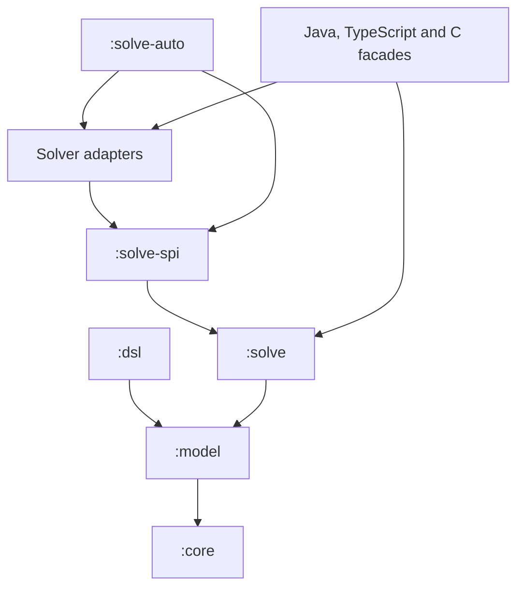
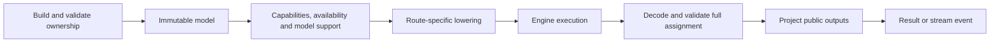

# Architecture

The dependency structure keeps model meaning independent of execution. Applications may use the representation and DSL without loading a solver. Adapters depend on the shared contracts and representation; the core does not depend on adapters or language facades.

## Layers and modules

The diagram shows the main dependency direction rather than every Gradle edge. `:solve-auto` dependencies on bundled adapters vary by platform; facade dependencies also vary with the operations they expose.

| Layer | Responsibility |
|---|---|
| `:core` | Sorts, variables and identities, exact numbers, domains, expression nodes, globals, traversal and ground evaluation |
| `:model` | Mutable `ConstraintScope`, frozen `ConstraintModel`, assertion metadata, integer objectives and output projection |
| `:dsl` | Kotlin operators and helpers, plus the Java-facing `Expressions` factories |
| `:solve` | Solver, stream, incremental-session and store interfaces; assignments, options, descriptors and result contracts |
| `:solve-spi` | Backend and compiler contracts, support reports, availability, registry, feature extraction, ranking and shared lifecycle machinery |
| Solver adapters | Translation into an engine representation, execution, decoding and validation |
| `:solve-auto` | `AutoBackend`: platform defaults, automatic solving, sequential fallback and bounded races |
| `:interop-java`, `:interop-js`, `:interop-c` | Language-specific call patterns and boundary representations |
| `:test-core`, `:test-solve` | Reusable representation and solver contracts, differential checks and a small finite test oracle |

The implemented external adapters are `:solve-z3`, `:solve-choco`, `:solve-cpsat`, `:solve-mip` and `:solve-minizinc`. The pure-Kotlin `:solve-kotlin` engine has its own [explanation](pure-kotlin-solver.md). `:solve-flatzinc` and `:solve-highs` are reserved modules, not operational adapters. HiGHS execution currently belongs to the MiniZinc and OR-Tools routes.

## From a model to a result

`ConstraintScope` allocates identities and checks expression ownership and sorts. The resulting model snapshots declarations and assertions, preserving their order. Entries can carry names, annotations and source locations. A null objective means satisfaction. Output projection defaults to all declared variables and can explicitly be empty.

Selection checks the model before solver creation. The backend SPI exposes a descriptor, an availability probe, a whole-model `support` check and a factory. Compiler implementations can expose `ConstraintCompiler` and `CompiledModel`, including a mapping from internal names to source variables. Direct adapters also have engine-specific translation layers; there is no requirement to turn every backend representation into a textual interchange format.

Lowering is where abstract globals become native engine operations or exact decompositions. Numeric range checks include intermediate expressions, not just variable bounds. MiniZinc lowering emits source that MiniZinc subsequently flattens. Direct routes build the engine's own objects. Hidden auxiliary variables belong to this translation and do not enter public output.

Adapters check full returned assignments against source constraints before applying output projection. Projection therefore cannot conceal an invalid value of an unreported variable. A result carries the answering engine/route, search status, termination reason and metadata. Enumeration and optimization use solution events followed by a completion event; the final event records what search established.

## Runtime ownership and platform code

Common code contains the typed representation and portable contracts. JVM code hosts Java bindings, native-library wrappers and command execution. JavaScript code integrates asynchronous Wasm runtimes and the MiniZinc Node/browser routes. Kotlin/Native uses the Z3 C API through a runtime-loaded library shim.

A model owns no process or native context. Solvers own their active searches, and sessions and streams have explicit close operations. JavaScript backend objects can additionally own a shared upstream runtime, so closing an individual solver and closing the loaded backend are distinct operations. These lifetimes are part of the execution contract, not model semantics.

The language facades sit outside the common API. Java exposes blocking calls, futures and iterators; TypeScript exposes promises, cancellation signals and asynchronous iteration; C exposes generated handles and exact decimal strings. Their dependencies do not flow back into the core. See the [Java](../reference/java-api.md), [TypeScript](../reference/typescript-api.md) and [C](../reference/c-api.md) references.

## Reuse and limits

Immutable models can be reused with different routes. This does not currently extend to portable serialized models, persisted identities or cross-process compilation caches. `VariableId` contains an in-memory owner; a future format would need local indices and fresh identity remapping when decoded.

Execution capabilities remain separate from the lowering pipeline. Incremental checks retain assertion state; stores expose reversible posting and, where supported, domain propagation. Their relationship is explained in [solving modes](solving-modes.md). The [backend contribution guide](../how-to/contributing/add-a-backend.md) covers the contracts an adapter must satisfy.
