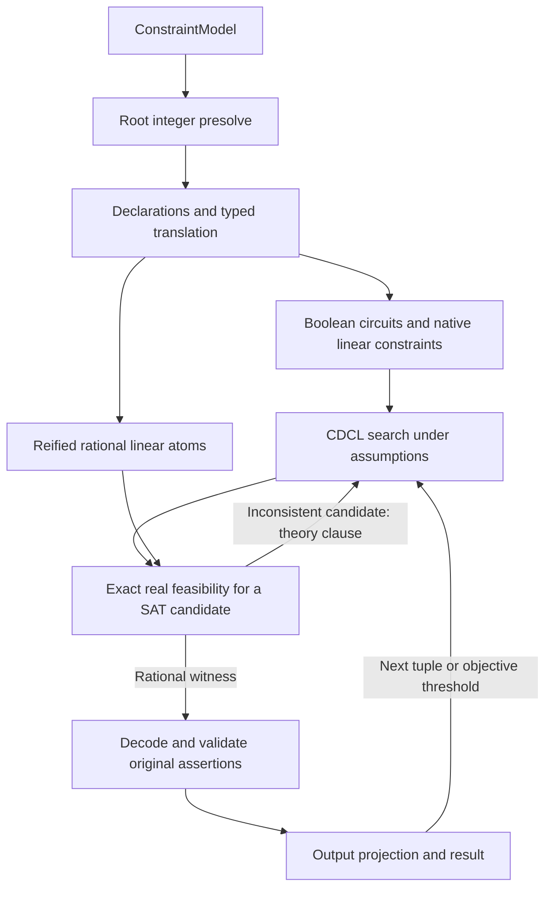

# The pure-Kotlin solver

The `kotlin/direct` route implements constraint solving in portable Kotlin: a finite arithmetic compiler, a conflict-driven SAT engine, and an exact rational linear feasibility checker. It can solve satisfaction models, optimize integer expressions, enumerate projected solutions, and maintain incremental assertion sessions. It is experimental and is not included in the published modules or the default automatic solver selection.

Its design puts portability and sound answers before specialized solving strength. The same production sources live in `solve-kotlin/src/commonMain`, with no external solver executable, JNI library, C binding, or WebAssembly solver binary. “Dependency-free” here means **no external solver runtime**: the module still uses `:solve-spi`, the project's arbitrary-precision integer/rational infrastructure, and Kotlin coroutines. See the [module build file][module-build] and [public API reference](/kt-constraints/api/index.html).

This page explains the implementation and the consequences of its choices. For operational instructions, see [choosing a solver](../how-to/choose-a-solver.md), [limits and cancellation](../how-to/limits-and-cancellation.md), [optimization](../how-to/optimize.md), and [incremental sessions](../how-to/incremental-sessions.md).

## A portable route within the solver architecture

[`KotlinBackend`][backend] implements `SolverBackend`. Its descriptor distinguishes the engine `kotlin` from the execution route `direct`. `availability()` reports available without probing an installation; `support(model, options)` delegates to [`KotlinSupport`][support]. `createSolver()` returns an `IncrementalConstraintSolver` implemented by [`KotlinSolver`][solver].

The descriptor advertises satisfaction, optimization, enumeration, incremental assertions, backtracking, assumptions, integer arithmetic, real arithmetic, bit-vectors, global constraints and unsat cores. These are capability categories, not promises to accept every possible expression of those kinds. Support inspection walks variables, constraints, the objective and decompositions, reporting unsupported expression classes and the decompositions it will use. Unsupported nodes are rejected even inside an inactive Boolean branch. A structurally supported model can still exceed compilation or search limits.

The route can participate in a caller-supplied `SolverRegistry` or [`AutoBackend`][auto-backend] through this same SPI. The platform bundles currently omit it, so adding `:solve-kotlin` does not make `AutoBackend` select it. The automatic-selection benchmark adds it explicitly for comparison. See [automatic solver selection](backends/selection.md) for ranking, fallback and racing.

Portable source and a delivered language facade are separate concerns. Kotlin/JVM, Kotlin/JS and Kotlin/Native can use the common implementation. Java boundary tests construct the backend and pass it through the blocking/async facade. JavaScript facade tests wrap it as a test dependency; that does not provide a published TypeScript loader for this route. The C facade uses Z3, rather than this engine. There is no Kotlin/Wasm target implied by using Kotlin/JS, and common code alone is not evidence of a packaged browser route. Consult [platform availability](../reference/platform-availability.md) for platform evidence.

## The supported mathematical fragment

The finite part is arbitrary precision, not unbounded search. An integer variable has a finite `IntDomain`, potentially with holes and endpoints far outside machine range. Every encoded intermediate integer also has conservative finite mathematical bounds. Real variables can be unbounded, but their real-variable dependence must be linear.

| Area | What this route represents |
|---|---|
| Boolean expressions | Variables, constants, negation, conjunction, disjunction, implication and equality, including nested predicates |
| Finite integer expressions | Constants, sums, differences, products, negation, weighted `LinearSum`, minimum, maximum, comparisons and Boolean-to-integer conversion |
| Mixed integer/real expressions | Exact integer-to-real embedding, rational constants, real sums/differences/negation, scaling by a rational constant, and equality or strict/non-strict order |
| Bit-vectors | Fixed-width addition, subtraction, multiplication, bitwise operations, negation, shifts, signed/unsigned comparisons and integer conversion |
| Globals | `AllDifferent`, `Element`, `Table`, Boolean cardinalities, and the built-in decomposable graph, scheduling, packing and automaton constraints |
| Objectives | One integer minimization or maximization expression, including finite nonlinear products |

Some familiar DSL operations are already compositions of these nodes. For example, `abs(x)` is `max(x, -x)`, and weighted soft-constraint minimization builds an integer objective. These do not require separate numerical algorithms.

This is not a solver for unrestricted integer variables, general nonlinear real arithmetic, real-valued objectives, division/remainder, or general string, set and array theories. A product of two finite integer terms is supported; multiplication of two real variables is not. An integer product can nevertheless be embedded into a linear real expression: the product is first encoded discretely, then supplied to the real theory as Boolean-weighted data. The support report is the authoritative check for the actual expression nodes, rather than an inference from the names of capability flags.

Exactness has a practical limit: arbitrary-precision values can demand circuits wider than the configured maximum. That produces a resource-limit outcome, not a truncated value.

## From model to witness

A SAT (Boolean satisfiability) solver searches for truth values satisfying a formula. A **literal**
is a Boolean variable or its negation; a **clause** is an OR of literals. The engine combines clauses
with arithmetic checks. **Conflict-driven clause learning (CDCL)** remembers reasons a candidate
failed so that later search avoids the same conflict. A **reified rational linear atom** is a
Boolean value standing for a rational arithmetic comparison. A **theory clause** rules out a
Boolean candidate whose arithmetic comparisons cannot hold together.

Each stream or session owns an isolated [`KotlinEngine`][engine]. The immutable `ConstraintModel` never stores mutable solver state. Within an engine, one SAT database and one translator survive successive checks.

Initialization first runs integer presolve, declares every model variable using its reduced domain, posts the root constraints, and, for batch optimization, compiles the objective and asserts its definedness. A presolve conflict becomes a permanent false clause. Sessions omit objective compilation because their checks answer satisfiability queries.

[`KotlinTranslation`][translation] maps source nodes to [`CompiledTerm`][compiled-term] values. Depending on the sort, a value is a SAT literal, an `IntegerEncoding`, a symbolic `IntegerLinear`, a `LinearForm`, or a bit-vector literal array. A separate literal records whether the expression is defined.

Translation uses an explicit stack of [`CompilationFrame`][compilation-frame] objects rather than recursive descent through ordinary expression children. [`CompilationCache`][cache] compares nodes by reference inside buckets by expression class, avoiding recursive structural `hashCode` and `equals` calls. Boolean gates have their own reusable gate cache. Sharing the same expression object can therefore avoid recompilation, although looking up a reference in a bucket still costs a linear scan.

After SAT and real feasibility agree, the translator decodes all declared variables. `Assignment.of` checks values against their declared domains; `KotlinEngine.validate` evaluates the original root assertions with `GroundEvaluator`. Sessions also validate active assertions and assumptions. Only then is the assignment projected onto public outputs. A violated source assertion raises `BackendExecutionException`; it is not returned as a feasible answer. This validation protects witnesses, while infeasibility and optimality still depend on the correctness of the encodings and search.

### Definedness is separate from truth

An `Element` expression is partial: its index must lie in `0 until values.size`. The circuit can compute some total bit pattern for an invalid index, but that bit pattern is not a valid source-level value.

Every parent combines the definedness literals of **all** its children. An assertion selects `truth AND definedness`. Thus, even if one side of a disjunction is true, an element on the other side still needs a valid index when the enclosing assertion is active. This matches the model's evaluation semantics; it is not programming-language short-circuit evaluation.

Root assertions and an active batch objective post their definedness permanently. A session assertion or temporary assumption selects its combined literal only while active. Popping an assertion therefore removes its index restriction as well as its truth requirement. [`KotlinSessionSafetySpec`][session-safety] tests these distinctions, including a true disjunction containing a partial element and an element used only as an objective.

## Root presolve: smaller domains without changing the model

[`IntegerPresolver`][presolver] operates only on unconditional root assertions, flattening root conjunctions. It does not narrow domains from one branch of a disjunction, a reified predicate, a session frame, or a temporary assumption.

[`AffineNormalizer`][normalizer] recognizes integer affine forms: constants, variables, sums, differences, negation and weighted sums. Products are affine when one normalized factor is constant, including a variable whose current domain is a singleton. Repeated variable coefficients are combined, so cancellation such as `x - x` is exact.

For an inequality of the form `sum(a_i * x_i) + c <= 0`, presolve computes each term's minimum contribution. If even the minimum total is positive, the assertion is contradictory. Otherwise it derives a necessary bound for each variable from the minimum contribution of the other terms. Negative coefficients use mathematical floor and ceiling division, preserving integer semantics for negative quotients. Equality runs the inequality in both directions; strict integer order is shifted by one.

Restrictions intersect the current interval domain. They retain holes and use interval operations rather than enumerating huge ranges. `AllDifferent` removes fixed values from unfixed variable operands, detects duplicate fixed values, and can refute the whole scope when the union of candidate values is smaller than the number of operands. This is a whole-scope pigeonhole check. It does not filter every **Hall subset**: a group of variables whose combined domains contain exactly as many values as variables, reserving those values for that group. Fewer values than variables proves inconsistency.

Presolve repeats until no domains change, a conflict is found, or its internal default of 64 passes is reached. Reaching the pass cap only leaves propagation incomplete. The original assertions are still compiled, so a missed presolve consequence is left for search.

[`ReversibleIntDomains`][domains] stores restrictions in a trail with source-assertion provenance, detached snapshots and owner-checked checkpoints. It does not mutate the model's variable domains. Although the store supports rollback internally, the SAT search does not run a CP domain-propagation queue over it. Presolve provenance is not a clause-learning explanation, and this route offers no propagating constraint-store API or domain-reflection/entailment interface. See [solving modes](solving-modes.md) for that API distinction.

## Integer encodings and arithmetic

### Binary values with an offset origin

[`IntegerEncoding`][integer-encoding] contains little-endian signed two's-complement literals and exact `min`/`max` bounds. A variable also retains its unsigned offset bits. [`BinaryArithmetic.variable`][binary] represents a variable as `minimum + offset`, where `offset` ranges over the span of its domain. Explicit interval-membership comparisons exclude holes and unused bit patterns.

This matters for a domain such as four consecutive integers near `2^200`: its independent choices need only two offset bits. Its mathematical value is still represented exactly, and other operations may require wide result circuits. A singleton becomes a constant; an empty domain posts a contradiction.

Bounds determine the signed width of each arithmetic result. Addition adds endpoint bounds; subtraction subtracts opposite endpoints; multiplication takes the minimum and maximum of the four endpoint products; negation reverses and negates the bounds. These bounds can be conservative when operands are correlated, but must never exclude a valid result. Width checks happen before allocating arithmetic outputs.

[`BitCircuit`][bit-circuit] builds ripple-carry adders, two's-complement subtraction and negation, shift-and-add products, comparisons and bitwise selection. Signed multiplication accounts for the negative weight of the multiplier's sign bit. An integer result is widened enough to hold its mathematical bounds; it does not inherit fixed-width wrapping. Constant folding and bound-separated comparisons avoid unnecessary gates. `IntMin` and `IntMax` reduce through comparisons and conditional selections.

### Bit-vectors keep fixed-width semantics

Bit-vectors reuse `BitCircuit` but keep the declared width instead of deriving an integer result width. Arithmetic wraps modulo `2^width`; comparisons explicitly select signed or unsigned interpretation. Unsigned conversion to an integer adds a zero sign bit, while signed conversion uses the existing sign bit and its negative weight.

Variable shifts use conditional stages for power-of-two distances. They inspect the whole encoded shift amount rather than converting it to a machine integer or masking it to the low bits. An amount at least as large as the width shifts every data bit away: left and logical-right shifts produce zero, while arithmetic-right shift fills with the original sign bit. This behavior also holds for amounts larger than a machine integer. See [exact reals and bit-vectors](../how-to/exact-reals-and-bitvectors.md) for modeling semantics.

### Value and order encodings supplement binary bits

Binary representation is compact but can propagate poorly for combinatorial relations. Two additional encodings apply to eligible variable domains:

| Encoding | Eligibility in the implementation | Purpose |
|---|---|---|
| [`DirectEncoding`][direct] | Nonconstant variable with at most 128 domain values | Creates `x = v` literals on demand, channelled to offset bits; exactly one value holds |
| [`OrderEncoding`][order] | Nonconstant variable with at most 4,096 domain values | Creates `x >= v` literals on demand using exact comparators, with monotonicity clauses |

Eligibility depends on the number of domain values, including sparse values, rather than the size of their numeric origin. Direct equalities help constant comparisons, table rows and element indices. For eligible top-level shifted variables, disequality becomes binary clauses forbidding equal shifted values; `AllDifferent` gets per-value constraints.

Order encodings recognize comparisons between eligible variables shifted by constants, or between such a term and a constant. A reified `x + a <= y + b` imposes threshold implications in both directions: the relation and its complement each have exact meaning. Strict comparison shifts one side by one. Bounds can then propagate through clauses rather than only through a binary comparator circuit. More complicated expressions retain the general exact encoding.

The domain thresholds are internal choices, not public configuration promises. Value/order channels do not replace the binary value and do not turn the solver into a public CP store.

### Symbolic linear sums and native propagation

[`IntegerLinear`][integer-linear] retains a constant and weighted encoded terms without immediately constructing adders. `LinearSum` and its supported surrounding addition, subtraction and negation preserve this form. A consumer that needs actual bits, such as multiplication or element selection, materializes it into exact circuits through [`LinearCompiler`][linear-compiler].

For comparisons involving symbolic sums, `LinearCompiler` collects weights over Boolean variables, preferably using the original offset bits to skip origin adders. It merges repeated/complemented literals and changes negative weights into positive weights on negated literals. The result is a reified pseudo-Boolean constraint of the form `sum(a_i * literal_i) <= bound`.

The native path uses checked machine-range coefficients. Currently the total's bit length must be at most 60, leaving room for the extra reification coefficient. If that guard fails, the compiler falls back to arbitrary-precision circuit arithmetic. Large coefficients never justify narrowing the mathematical values to `Long`.

[`SatLinear`][sat-linear] maintains the sum of processed true literals for each native constraint. If a literal's weight exceeds the remaining slack, it must become false. A negative slack is a conflict. Sums roll back with the SAT trail. When conflict analysis needs a propagation reason, it constructs a clause from enough earlier true literals, considering the largest weights first. These explanations let native arithmetic consequences participate in the same learning mechanism as ordinary clauses.

This propagation concerns finite Boolean-weighted constraints. It is distinct from the rational real feasibility algorithm below, and provides no **LP relaxation** (linear programming with integer restrictions relaxed to allow fractional values) or objective bound from continuous optimization.

## How global constraints are lowered

Global nodes remain abstract in the model. This backend chooses their encodings during translation. Its support report describes decompositions, although specialized root posting can strengthen or replace some of the general circuit encodings. See [global constraints](global-constraints.md) for their modeling role.

| Construct | Lowering used by this route |
|---|---|
| `AllDifferent` | In a general Boolean context, conjunction of reified pairwise disequalities. When plain variable domains form a permutation, additional clauses require every value to occur. Eligible top-level variables shifted by constants instead use direct value literals with native at-most-one constraints per value, constant exclusions, a whole-scope pigeonhole check and value coverage for permutations. |
| `Element` | Chain of exact integer selections driven by index equalities, plus separate index definedness. The entries can themselves be integer expressions. |
| `Table` | Disjunction of rows; each row is a conjunction of operand equalities to its constants. An empty allowed-row set is false. |
| `BoolCardinality` | Adds zero-or-one Boolean encodings in a binary counting circuit, then compares the sum with the count for at-most, at-least or exactly. |
| `Inverse` | Range constraints and all pairwise equivalences `direct[i] = j` iff `inverse[j] = i`. |
| `Circuit`, `SubCircuit` | Range, permutation and walk/reachability formulas, described below. |
| `Cumulative` | Resource-usage inequalities at the starts of positive-demand tasks, using Boolean indicators of which other tasks are running. |
| `BinPacking` | Valid bin indices and one exact weighted indicator sum for each bin's load. |
| `NoOverlap2D` | For each rectangle pair, a disjunction of four possible separating sides. Touching edges are permitted. |
| `Regular` | A sequence of element lookups through a dense automaton transition table, including a dead state, followed by an accepting-state test. |

The structural constraints implement `DecomposableConstraint`. `KotlinTranslation` uses their **variable-free `decomposition` property**, including when the constraint is reified. It does not call the alternative `decompose(auxiliaries)` method available on some nodes. The source definitions are [`Circuit.kt`][graph-source], [`SubCircuit.kt`][subcircuit-source], [`Inverse.kt`][inverse-source], [`Cumulative.kt`][scheduling-source], [`BinPacking.kt`][binpacking-source], [`NoOverlap2D.kt`][nooverlap-source] and [`Regular.kt`][regular]. There are no dedicated matching, cumulative timetable, edge-finding, rectangle or automaton domain propagators here.

For `Cumulative`, positive constant durations and nonnegative constant demands mean the usage profile can rise only when a demanding task starts. Checking each such start is sufficient. The active interval is half-open: `start <= t < start + duration`, so one task may start exactly when another ends. `disjunctive` is the DSL's unit-demand, unit-capacity `Cumulative` construction. No integer time horizon is enumerated by this decomposition.

`Regular` clamps symbols outside its alphabet span onto dead columns, so every internal element lookup remains defined. Missing transitions lead to the dead state. Its dense table depends on the distance between the smallest and largest symbols, not merely the number of transitions; a sparse alphabet with far-apart values can therefore be expensive or exceed the representation used to construct the table.

Other named DSL constraints are built before backend translation. [`CountingDsl.kt`][counting-dsl] implements `count` as sums of equality indicators, `among` as sums of membership indicators, `globalCardinality` as count equalities, and `nValue` by counting operands unequal to all earlier operands. [`OrderingDsl.kt`][ordering-dsl] implements increasing/decreasing sequences as adjacent comparisons and lexicographic order as nested equality/order alternatives. They inherit the exactness and costs of those smaller nodes.

### Graph cycles are not Boolean gate circuits

The compiler's `compiler.circuit.Circuit` is a Boolean gate builder. The model's `core.global.graph.Circuit` is a constraint on successor indices. Their shared name does not imply a specialized graph search engine.

For a graph `Circuit`, range checks and `AllDifferent` make the successors a permutation. Starting at node zero, the decomposition follows successor lookups and forbids a return to zero before all nodes have been visited. In a permutation, that rules out a shorter cycle containing zero and therefore forces one cycle through every node. Internal lookups use clamped indices; explicit range predicates determine truth without making the lookup undefined when the whole graph constraint is negated.

For `SubCircuit`, self-successors mark excluded nodes. The remaining nodes must form one cycle, or there may be no included nodes. Its variable-free form requires each included node to reach every other included node within the bounded successor walk. This permits exclusion while ruling out two disjoint nontrivial cycles.

These nested walks can expand substantially during lowering and evaluation. The compact auxiliary-position encodings present in the core source are not selected by this route. A graph constraint being accepted thus says nothing about native subtour propagation or suitability for large traveling-salesman instances.

## The SAT search engine

[`Circuit`][circuit] turns Boolean operations into fully reified **Tseitin-style clauses**: auxiliary Boolean variables represent gates, and clauses enforce each gate’s relationship to its inputs. Negation changes a literal's sign. AND and XOR gates simplify constants, repeated operands and complements; commutative gate keys allow reuse. OR is built through negated AND, and conditional selection through Boolean gates. Full reification is what allows arithmetic and global predicates to be negated or nested without losing the reverse implication.

[`SatSolver`][sat-solver] uses conflict-driven clause learning (CDCL), rather than enumerating all integer tuples. Before the details: **watched literals** let propagation revisit only clauses affected by a change;
a **blocker** cheaply records a literal that already satisfies a clause. A saved **phase** is the last
truth value tried for a variable. The **first unique implication point (UIP)** identifies a shared
cause of a conflict, allowing search to jump back past irrelevant decisions. A **Luby schedule**
varies restart intervals so search can revisit decisions while retaining learned clauses.
**Literal block distance** counts the decision levels represented in a learned clause, helping
the engine choose which clauses to retain. Its core structures and policies are:

1. **Propagation.** [`SatPropagation`][propagation] uses two watched literals per non-unit clause. A true blocker literal can establish clause satisfaction without loading the clause. It processes the assignment trail, combines clause propagation with `SatLinear` propagation, and pauses at safe boundaries for cooperative checks.
2. **Decisions.** [`SatState`][sat-state] stores assignments, decision levels, reasons, trail positions, saved phases and variable activities in primitive arrays. [`SatOrder`][sat-order] is a max-heap for activity-based branching. Conflict participants get activity bumps, with decay implemented by increasing the bump increment. Saved phases guide the next polarity. Floating-point activity scores affect search order only; they never approximate model arithmetic.
3. **Learning and backjumping.** [`SatConflictAnalysis`][conflict-analysis] resolves reasons backwards to the first unique implication point. It minimizes the learned clause using available reasons, backtracks nonchronologically to its asserting level, and enqueues the remaining forced literal. Native linear reasons enter the same analysis.
4. **Restarts.** A Luby schedule starts with a conflict unit of 100. On a restart, search returns to level zero and then reapplies temporary assumptions. Permanent clauses and learned consequences survive.
5. **Database reduction.** [`SatDatabase`][database] ranks learned clauses by literal block distance and size. After a growing threshold, it deletes worse clauses while retaining those spanning at most two decision levels. Deleted watches are removed lazily. Input clauses are retained.

At each `solve`, assignments and native running sums reset; clauses, learned consequences, activity and phase information remain reusable. Assumptions occupy separate decision levels, including empty levels for assumptions already implied. If an assumption contradicts propagation, the check is unsatisfiable under those assumptions. Assumptions are not inserted as permanent unit clauses.

The engine is single-consumer. It rejects formula mutation and reentrant solving during a SAT check. It also copies the assumption array before suspension, so caller mutation cannot change an in-flight search.

## Exact real feasibility and mixed arithmetic

[`LinearForm`][linear-form] separates rational coefficients of real variables, rational coefficients of Boolean variables, and a rational constant. An integer-to-real conversion expands the signed integer bits into their exact power-of-two weights; repeated and complemented literals are combined. It does not replace an integer by a continuous variable.

If a comparison has **no remaining real-variable coefficients**, the translator multiplies by the exact positive least common multiple of the rational denominators and builds an integer circuit comparison. This preserves strictness and equality without entering real candidate checking. For example, an integer-only expression written with rational scaling remains a discrete SAT problem.

Otherwise, [`RealAtom`][real-atom] gives a SAT literal the meaning `form <= 0` or `form < 0`. Equality is the conjunction of two non-strict inequalities. A false atom selects the exact complementary inequality: negating a non-strict relation produces a strict one, and vice versa.

For a complete SAT candidate, `KotlinEngine.check` fixes the Boolean contributions and sends the selected inequalities to [`LinearFeasibility`][real-feasibility]. This is **Fourier–Motzkin elimination, not simplex**:

1. Drop zero coefficients, reject contradictory constant rows, and merge proportional rows, retaining the tightest bound and strictness.
2. Choose a real variable with the smallest product of its positive-row and negative-row counts, to reduce the next expansion.
3. Combine each upper/lower row pair to eliminate that variable. A derived inequality is strict if either parent is strict. Rows independent of the variable remain.
4. Save affected rows in elimination frames, then reconstruct values in reverse order once the projected system is feasible.

Reconstruction substitutes already chosen values to obtain lower and upper endpoints. With two distinct endpoints, their rational midpoint is a witness; equal endpoints are allowed only when both are closed. For a lone open endpoint, the implementation chooses one unit inside the unbounded direction. Unconstrained variables receive zero. No epsilon, floating-point tolerance, or numerical feasibility threshold is used.

If the candidate is inconsistent, the engine learns a coarse theory clause negating the current polarities of **all compiled real atoms and all embedded Boolean bits used in their forms**. Including bit assignments matters: impossibility at one integer value must not eliminate other integer values. The engine then asks SAT for another candidate.

This is a lazy interaction: real feasibility runs after a complete SAT assignment, without partial theory propagation. Each check constructs a fresh elimination problem; there is no persistent simplex tableau across session checks. The learned clause is sound but may be much larger than a minimal conflicting subset. In a mixed session, permanent atom definitions and temporary assertion selection keep these clauses valid after a frame is popped. [`KotlinTheorySessionSpec`][theory-session] specifically checks that conflicting mixed-real scopes do not poison later satisfiable checks.

Finite Boolean search plus exact linear elimination supplies a decision procedure for the supported satisfaction fragment if resources suffice. Practical limits still matter: elimination can generate exponentially many rows, and exact rational numerators and denominators can grow substantially.

## Integer optimization and the meaning of a proof

[`KotlinStream`][stream] and [`OptimizationState`][optimization] implement an objective-bound search over the same engine. The objective can be a binary encoding or a symbolic linear expression. A minimization is treated as maximization of the negated score.

The conservative expression bounds supply an initial upper score `U`. The first successful unconstrained check supplies a best score `B`. Subsequent checks assume a threshold at the midpoint of the remaining integer interval: `B + ceil((U - B) / 2)`.

A satisfiable threshold check yields a strictly improving incumbent, whose actual objective is evaluated from the original expression. An unsatisfiable threshold check proves the upper score is below that threshold and sets `U` to `threshold - 1`. When the best score reaches the remaining upper bound, no better integer value can exist. The stream then completes with `OPTIMAL` and matching objective value and bound.

For maximization, `bestBound` is an upper bound; for minimization, the sign conversion makes it a lower bound. These are mathematical bounds from the encoding and refuted threshold queries, not estimates of likely solution quality. An initial unsatisfiable model yields `INFEASIBLE`. A limit before any witness yields `UNKNOWN`; after an incumbent, it yields `FEASIBLE`, retaining the incumbent and any available bound. A solution limit can stop before an optimality completion event, even if the last incumbent happens to be optimal.

The proof is internal search evidence, not an exported SAT proof log or independently checkable optimization certificate. There is no continuous objective optimization, unbounded-objective detection, or LP relaxation in this loop. Finite integer domains already bound the supported integer objectives. See [results and statuses](../reference/results-and-statuses.md) for the public result semantics.

## Enumeration is over the output projection

For a satisfaction stream, [`ProjectionBlocker`][blocker] builds the disjunction “at least one projected variable differs from this answer.” The next pull posts it permanently to that stream's engine. Boolean, integer, real and bit-vector outputs each use their exact equality operation.

Blocking only the projected tuple keeps hidden variables existential. Several hidden assignments that produce the same public tuple yield one answer. With no output variables, the first witness is followed by a false blocking clause, so there is at most one answer. A finite discrete projection is exhausted when its next blocked check is unsatisfiable.

Projected real solution sets can be infinite. The stream returns distinct rational witnesses, not a symbolic region and not a finite enumeration guarantee. A solution limit is useful even for a bounded real interval, which can contain infinitely many rational points. No ordering of witnesses is promised.

An optimization stream emits improving incumbents rather than every feasible assignment or every assignment tied at the optimum. It advances using thresholds instead of projection blockers. Both kinds are cold, pull-driven searches with completion events; the managed one-result satisfaction shortcut returns the first witness without exhausting the projection. See [enumerating solutions](../how-to/enumerate-solutions.md).

## Incremental sessions: permanent definitions, temporary assertions

[`KotlinSession`][session] retains one engine after lazy initialization. Root constraints are permanent. Added assertions are stored in frames and compiled lazily into literals. Each check passes the active assertion literals and the current assumption literals to SAT as temporary assumptions.

`push()` creates a user checkpoint. `popTo(checkpoint)` removes that frame and all newer frames, consuming those checkpoints. Session declarations are scoped too: popped variables cease to be known to the public session, and assertions must use currently declared variables. Compiled definitions can remain internally without keeping their popped assertions active. Successful checks project onto model outputs plus active session declarations.

User checkpoints are not SAT decision levels. A SAT check may backjump or restart many times while the same user frame remains active. Conversely, popping a user frame does not erase sound learned clauses or force the remaining model to be recompiled. Each new check resets SAT assignments and rebuilds rational feasibility, while reusing the permanent encodings and learned consequences.

The current unsat core is the **entire input assumption list** whenever the active assertions plus those assumptions are unsatisfiable. It is a sufficient source-level core, not necessarily small or irreducible. If active assertions are inconsistent without assumptions, the returned list may be empty. Named root assertions are not extracted as an irreducible infeasible subsystem. No proof certificate accompanies a core.

A session check ignores the model's objective and returns `SATISFIABLE`, `UNSATISFIABLE`, or `UNKNOWN`. Each check gets a fresh timeout/work budget. Overlapping checks and mutations are rejected, assumptions are copied before the first suspension, and closing the owning solver closes its sessions. These guarantees do not imply CP domain reflection, propagation queries, entailment or a CLP constraint store.

## Limits, interruption and diagnostics

[`KotlinConfiguration`][configuration] supplies engine limits:

| Setting | Default | What it bounds |
|---|---:|---|
| `maxBitWidth` | 16,384 | One compiled arithmetic width |
| `maxVariables` | 1,000,000 | Boolean variables, including compiler auxiliaries |
| `maxClauses` | 4,000,000 | Operations posting clauses or native linear constraints through `Circuit` |
| `workLimit` | No limit | Deterministic work accounting across compilation, search and real checks |

`SolveOptions` supplies a timeout and solution limit. [`SearchBudget`][budget] uses monotonic time, close signals, coroutine activity checks and cooperative yielding. Compiler and arithmetic loops have checkpoints. [`SatBudget`][sat-budget] batches hot-loop work before calling the suspending checkpoint; this avoids a coroutine call for every SAT operation. A work unit is implementation accounting, not one search node or one CPU instruction, and should not be treated as comparable to another backend's work count.

A stream owns one budget across its pulls, so time spent between pulls can consume its elapsed timeout. A session gets a new budget for each check. Hitting an engine or time limit raises internal `SearchStopped`, translated to the corresponding result termination reason without inventing infeasibility. Coroutine cancellation propagates through the managed lifecycle; it is not a proof result. Close signals interruption without clearing arrays that an active suspended operation still owns.

Cancellation is cooperative, not hard preemption. Individual arbitrary-precision operations are synchronous; some core traversal and ground-evaluation work has coarser interruption granularity. The configured limits are also not a total-memory ceiling: SAT-learned clauses, lazy explanations and elimination rows are not all charged against an independent fixed memory cap. Learned-clause reduction improves retention behavior without establishing such a ceiling.

Completed checks and stream completions can report `work`, `variables`, `compiledClauses`, `decisions`, `conflicts`, `propagations`, `theoryConflicts` and `presolveReductions` in metadata. SAT counts accumulate on the persistent engine, while session work belongs to the current check's budget. An interrupted operation can omit engine statistics. The managed first-witness satisfaction shortcut does not carry the stream's completion statistics; consume completion when those diagnostics are needed.

## How correctness is checked

The implementation has several complementary layers of evidence. None replaces the others, and source inspection is distinct from executing a suite on a particular platform.

| Layer | Checks in the repository |
|---|---|
| Shared solver behavior | [`KotlinBackendSpec`][backend-spec] includes `solverContract`, `incrementalContract` and `differentialContract` from `:test-solve`, without excluding the finite nonlinear case. |
| Independent finite oracle | The shared [differential catalogue][differential-cases] compares statuses, exact solution sets or objective values against exhaustive `FiniteOracle` solving. Cases include reification, structural globals, holes, products, hidden outputs and optimization. Encoding-specific specs add oracle comparisons. |
| SAT kernel | [`SatSolverSpec`][sat-spec] covers every subset of a two-variable clause catalogue, seeded small formulas in **conjunctive normal form (CNF)**—an AND of clauses, each an OR of literals—against truth tables, assumptions, learned-clause reuse and pigeonhole conflicts. [`SatLinearSpec`][sat-linear-spec] counts models against exhaustive truth tables for weighted constraints mixed with clauses. |
| Arithmetic circuits | [`BinaryArithmeticSpec`][binary-spec] checks signed arithmetic, holes, huge origins, width limits and exact results outside machine range. It also assumes an incorrect encoded result and requires UNSAT. [`BitVectorCircuitSpec`][bv-spec] exhaustively exercises symbolic three-bit operators and comparisons, plus oversized shifts and conversions. |
| Real theory | [`LinearFeasibilitySpec`][real-spec] checks reconstructed rational witnesses, strict boundary contradictions, unbounded directions, proportional rows, generated feasible systems and interruption. Integer embedding and discrete-real predicate specs check exact signed weights and denominator clearing. |
| Presolve and restoration | [`IntegerPresolverSpec`][presolve-spec] independently enumerates small affine witnesses to ensure narrowing preserves them. Domain-store tests exercise holes, detached snapshots and stale/foreign checkpoints. |
| Lifecycle and scopes | Session safety, snapshot and theory-session tests cover temporary definedness, zero-timeout reuse, copied assumptions, sufficient cores, scope restoration and independent same-name bindings. SAT interruption tests verify retry after cancellation. |
| Language boundaries | [`KotlinJavaUsageSpec`][java-spec] exercises actual Java sources through blocking solving, futures, enumeration, exact arithmetic and sessions. [`KotlinFacadeSpec`][js-spec] exercises exported JavaScript methods dynamically, including Promises, `bigint`, rational strings, async iterators, sessions and an aborted signal. This is not evidence of a published TypeScript loader for this backend. |

The common test sources apply to JVM, JS and Native builds. Cross-platform assertions check behavior rather than requiring a particular branching order or witness. The finite oracle supplies an independent search algorithm, although both implementations still share the public modeling semantics; exhaustive circuit truth tables and direct arithmetic expectations add checks below that shared layer. Witness evaluation catches invalid answers, but cannot alone certify all infeasibility answers or all possible models.

## Performance consequences and current limits

The implementation favors a compact common engine and exact representations. Its costs follow from that choice:

- Offset encoding keeps narrow domains compact even at huge numeric origins. Full result widths still matter, particularly for products and integer-to-real embeddings.
- Reused gates, direct values, order thresholds and native weighted propagation can avoid expensive generic circuits. Recognizable root `AllDifferent` constraints also gain permutation coverage and pigeonhole checks. These strengths depend on expression shape and domain size.
- Binary products use nested shift-and-add work. Reified pairwise distinctness and large allowed tables can create many gates or clauses. Structural graph walks, dense automaton tables and scheduling decompositions add further size costs.
- Optimization proves bounds by repeated feasibility checks. Without LP relaxation or specialized scheduling/global propagation, finding a good incumbent can be much easier than proving that none is better.
- Fourier–Motzkin elimination can expand exponentially. It is rerun for each complete candidate, and coarse mixed-theory conflict clauses can allow substantial repeated search.
- Referential compilation/support buckets can require quadratic scanning. Other core, presolve and evaluation traversals can revisit shared expression occurrences; explicit compiler frames do not make every operation on a **directed acyclic graph (DAG)** of shared expressions linear or every traversal immune to deep/shared-expression costs.
- Sessions retain definitions and learned consequences after pop. This helps reuse, but a long-lived session is not guaranteed to recover the memory used by removed assertions.

The repository's measurement tools separate different questions. [`KotlinBenchmark`][phase-benchmark] records model construction, engine setup, combined presolve/compilation, first check/decode/validation, output projection and session restoration phases. [`KotlinFamilyBenchmark`][family-benchmark] measures seeded catalogue instances on fresh solvers after warm-up. [`KotlinPlatformBenchmarkSpec`][platform-benchmark] runs an opt-in catalogue on each target, while the automatic-selection benchmark compares explicitly selected routes. The module configures a release Native test binary for measurement; ordinary debug-test timings should not be treated as release-runtime performance.

Those harnesses verify known answers alongside measurements, but no universal runtime or relative speed follows from their existence. Instance family, seed, proof requirements, runtime warm-up and Native optimization mode affect results. See [benchmarks](../reference/benchmarks.md) for measurement evidence and [running tests and benchmarks](../how-to/contributing/run-tests-and-benchmarks.md) for the workflow.

Use this route when a portable implementation with no external solver installation fits the supported model and its resource needs. Use the [solver/route reference](../reference/solvers-and-routes.md) to compare alternatives when native global propagation, stronger optimization bounds or broader SMT theories are needed.

[module-build]: https://github.com/gciatto/kt-constraints/blob/develop/solve-kotlin/build.gradle.kts
[backend]: https://github.com/gciatto/kt-constraints/blob/develop/solve-kotlin/src/commonMain/kotlin/io/github/gciatto/ktconstraints/solve/kotlin/KotlinBackend.kt
[support]: https://github.com/gciatto/kt-constraints/blob/develop/solve-kotlin/src/commonMain/kotlin/io/github/gciatto/ktconstraints/solve/kotlin/KotlinSupport.kt
[solver]: https://github.com/gciatto/kt-constraints/blob/develop/solve-kotlin/src/commonMain/kotlin/io/github/gciatto/ktconstraints/solve/kotlin/runtime/KotlinSolver.kt
[auto-backend]: https://github.com/gciatto/kt-constraints/blob/develop/solve-auto/src/commonMain/kotlin/io/github/gciatto/ktconstraints/solve/auto/AutoBackend.kt
[engine]: https://github.com/gciatto/kt-constraints/blob/develop/solve-kotlin/src/commonMain/kotlin/io/github/gciatto/ktconstraints/solve/kotlin/runtime/KotlinEngine.kt
[translation]: https://github.com/gciatto/kt-constraints/blob/develop/solve-kotlin/src/commonMain/kotlin/io/github/gciatto/ktconstraints/solve/kotlin/compiler/KotlinTranslation.kt
[compiled-term]: https://github.com/gciatto/kt-constraints/blob/develop/solve-kotlin/src/commonMain/kotlin/io/github/gciatto/ktconstraints/solve/kotlin/compiler/CompiledTerm.kt
[compilation-frame]: https://github.com/gciatto/kt-constraints/blob/develop/solve-kotlin/src/commonMain/kotlin/io/github/gciatto/ktconstraints/solve/kotlin/compiler/CompilationFrame.kt
[cache]: https://github.com/gciatto/kt-constraints/blob/develop/solve-kotlin/src/commonMain/kotlin/io/github/gciatto/ktconstraints/solve/kotlin/compiler/CompilationCache.kt
[presolver]: https://github.com/gciatto/kt-constraints/blob/develop/solve-kotlin/src/commonMain/kotlin/io/github/gciatto/ktconstraints/solve/kotlin/cp/presolve/IntegerPresolver.kt
[normalizer]: https://github.com/gciatto/kt-constraints/blob/develop/solve-kotlin/src/commonMain/kotlin/io/github/gciatto/ktconstraints/solve/kotlin/cp/presolve/AffineNormalizer.kt
[domains]: https://github.com/gciatto/kt-constraints/blob/develop/solve-kotlin/src/commonMain/kotlin/io/github/gciatto/ktconstraints/solve/kotlin/cp/ReversibleIntDomains.kt
[integer-encoding]: https://github.com/gciatto/kt-constraints/blob/develop/solve-kotlin/src/commonMain/kotlin/io/github/gciatto/ktconstraints/solve/kotlin/compiler/encoding/IntegerEncoding.kt
[binary]: https://github.com/gciatto/kt-constraints/blob/develop/solve-kotlin/src/commonMain/kotlin/io/github/gciatto/ktconstraints/solve/kotlin/compiler/circuit/BinaryArithmetic.kt
[bit-circuit]: https://github.com/gciatto/kt-constraints/blob/develop/solve-kotlin/src/commonMain/kotlin/io/github/gciatto/ktconstraints/solve/kotlin/compiler/circuit/BitCircuit.kt
[direct]: https://github.com/gciatto/kt-constraints/blob/develop/solve-kotlin/src/commonMain/kotlin/io/github/gciatto/ktconstraints/solve/kotlin/compiler/encoding/DirectEncoding.kt
[order]: https://github.com/gciatto/kt-constraints/blob/develop/solve-kotlin/src/commonMain/kotlin/io/github/gciatto/ktconstraints/solve/kotlin/compiler/encoding/OrderEncoding.kt
[integer-linear]: https://github.com/gciatto/kt-constraints/blob/develop/solve-kotlin/src/commonMain/kotlin/io/github/gciatto/ktconstraints/solve/kotlin/compiler/linear/IntegerLinear.kt
[linear-compiler]: https://github.com/gciatto/kt-constraints/blob/develop/solve-kotlin/src/commonMain/kotlin/io/github/gciatto/ktconstraints/solve/kotlin/compiler/linear/LinearCompiler.kt
[sat-linear]: https://github.com/gciatto/kt-constraints/blob/develop/solve-kotlin/src/commonMain/kotlin/io/github/gciatto/ktconstraints/solve/kotlin/sat/cdcl/SatLinear.kt
[graph-source]: https://github.com/gciatto/kt-constraints/blob/develop/core/src/commonMain/kotlin/io/github/gciatto/ktconstraints/core/global/graph/Circuit.kt
[subcircuit-source]: https://github.com/gciatto/kt-constraints/blob/develop/core/src/commonMain/kotlin/io/github/gciatto/ktconstraints/core/global/graph/SubCircuit.kt
[inverse-source]: https://github.com/gciatto/kt-constraints/blob/develop/core/src/commonMain/kotlin/io/github/gciatto/ktconstraints/core/global/graph/Inverse.kt
[scheduling-source]: https://github.com/gciatto/kt-constraints/blob/develop/core/src/commonMain/kotlin/io/github/gciatto/ktconstraints/core/global/scheduling/Cumulative.kt
[binpacking-source]: https://github.com/gciatto/kt-constraints/blob/develop/core/src/commonMain/kotlin/io/github/gciatto/ktconstraints/core/global/scheduling/BinPacking.kt
[nooverlap-source]: https://github.com/gciatto/kt-constraints/blob/develop/core/src/commonMain/kotlin/io/github/gciatto/ktconstraints/core/global/scheduling/NoOverlap2D.kt
[regular]: https://github.com/gciatto/kt-constraints/blob/develop/core/src/commonMain/kotlin/io/github/gciatto/ktconstraints/core/global/extensional/Regular.kt
[counting-dsl]: https://github.com/gciatto/kt-constraints/blob/develop/dsl/src/commonMain/kotlin/io/github/gciatto/ktconstraints/dsl/CountingDsl.kt
[ordering-dsl]: https://github.com/gciatto/kt-constraints/blob/develop/dsl/src/commonMain/kotlin/io/github/gciatto/ktconstraints/dsl/OrderingDsl.kt
[circuit]: https://github.com/gciatto/kt-constraints/blob/develop/solve-kotlin/src/commonMain/kotlin/io/github/gciatto/ktconstraints/solve/kotlin/compiler/circuit/Circuit.kt
[sat-solver]: https://github.com/gciatto/kt-constraints/blob/develop/solve-kotlin/src/commonMain/kotlin/io/github/gciatto/ktconstraints/solve/kotlin/sat/SatSolver.kt
[propagation]: https://github.com/gciatto/kt-constraints/blob/develop/solve-kotlin/src/commonMain/kotlin/io/github/gciatto/ktconstraints/solve/kotlin/sat/cdcl/SatPropagation.kt
[sat-state]: https://github.com/gciatto/kt-constraints/blob/develop/solve-kotlin/src/commonMain/kotlin/io/github/gciatto/ktconstraints/solve/kotlin/sat/cdcl/SatState.kt
[sat-order]: https://github.com/gciatto/kt-constraints/blob/develop/solve-kotlin/src/commonMain/kotlin/io/github/gciatto/ktconstraints/solve/kotlin/sat/cdcl/SatOrder.kt
[conflict-analysis]: https://github.com/gciatto/kt-constraints/blob/develop/solve-kotlin/src/commonMain/kotlin/io/github/gciatto/ktconstraints/solve/kotlin/sat/cdcl/SatConflictAnalysis.kt
[database]: https://github.com/gciatto/kt-constraints/blob/develop/solve-kotlin/src/commonMain/kotlin/io/github/gciatto/ktconstraints/solve/kotlin/sat/cdcl/SatDatabase.kt
[linear-form]: https://github.com/gciatto/kt-constraints/blob/develop/solve-kotlin/src/commonMain/kotlin/io/github/gciatto/ktconstraints/solve/kotlin/compiler/linear/LinearForm.kt
[real-atom]: https://github.com/gciatto/kt-constraints/blob/develop/solve-kotlin/src/commonMain/kotlin/io/github/gciatto/ktconstraints/solve/kotlin/compiler/linear/RealAtom.kt
[real-feasibility]: https://github.com/gciatto/kt-constraints/blob/develop/solve-kotlin/src/commonMain/kotlin/io/github/gciatto/ktconstraints/solve/kotlin/arithmetic/LinearFeasibility.kt
[stream]: https://github.com/gciatto/kt-constraints/blob/develop/solve-kotlin/src/commonMain/kotlin/io/github/gciatto/ktconstraints/solve/kotlin/runtime/KotlinStream.kt
[optimization]: https://github.com/gciatto/kt-constraints/blob/develop/solve-kotlin/src/commonMain/kotlin/io/github/gciatto/ktconstraints/solve/kotlin/search/OptimizationState.kt
[blocker]: https://github.com/gciatto/kt-constraints/blob/develop/solve-kotlin/src/commonMain/kotlin/io/github/gciatto/ktconstraints/solve/kotlin/search/ProjectionBlocker.kt
[session]: https://github.com/gciatto/kt-constraints/blob/develop/solve-kotlin/src/commonMain/kotlin/io/github/gciatto/ktconstraints/solve/kotlin/runtime/KotlinSession.kt
[configuration]: https://github.com/gciatto/kt-constraints/blob/develop/solve-kotlin/src/commonMain/kotlin/io/github/gciatto/ktconstraints/solve/kotlin/KotlinConfiguration.kt
[budget]: https://github.com/gciatto/kt-constraints/blob/develop/solve-kotlin/src/commonMain/kotlin/io/github/gciatto/ktconstraints/solve/kotlin/search/SearchBudget.kt
[sat-budget]: https://github.com/gciatto/kt-constraints/blob/develop/solve-kotlin/src/commonMain/kotlin/io/github/gciatto/ktconstraints/solve/kotlin/sat/SatBudget.kt
[backend-spec]: https://github.com/gciatto/kt-constraints/blob/develop/solve-kotlin/src/commonTest/kotlin/io/github/gciatto/ktconstraints/solve/kotlin/KotlinBackendSpec.kt
[differential-cases]: https://github.com/gciatto/kt-constraints/blob/develop/test-solve/src/commonMain/kotlin/io/github/gciatto/ktconstraints/test/solve/DifferentialCase.kt
[sat-spec]: https://github.com/gciatto/kt-constraints/blob/develop/solve-kotlin/src/commonTest/kotlin/io/github/gciatto/ktconstraints/solve/kotlin/sat/SatSolverSpec.kt
[sat-linear-spec]: https://github.com/gciatto/kt-constraints/blob/develop/solve-kotlin/src/commonTest/kotlin/io/github/gciatto/ktconstraints/solve/kotlin/sat/SatLinearSpec.kt
[binary-spec]: https://github.com/gciatto/kt-constraints/blob/develop/solve-kotlin/src/commonTest/kotlin/io/github/gciatto/ktconstraints/solve/kotlin/compiler/BinaryArithmeticSpec.kt
[bv-spec]: https://github.com/gciatto/kt-constraints/blob/develop/solve-kotlin/src/commonTest/kotlin/io/github/gciatto/ktconstraints/solve/kotlin/compiler/BitVectorCircuitSpec.kt
[real-spec]: https://github.com/gciatto/kt-constraints/blob/develop/solve-kotlin/src/commonTest/kotlin/io/github/gciatto/ktconstraints/solve/kotlin/arithmetic/LinearFeasibilitySpec.kt
[presolve-spec]: https://github.com/gciatto/kt-constraints/blob/develop/solve-kotlin/src/commonTest/kotlin/io/github/gciatto/ktconstraints/solve/kotlin/cp/IntegerPresolverSpec.kt
[session-safety]: https://github.com/gciatto/kt-constraints/blob/develop/solve-kotlin/src/commonTest/kotlin/io/github/gciatto/ktconstraints/solve/kotlin/KotlinSessionSafetySpec.kt
[theory-session]: https://github.com/gciatto/kt-constraints/blob/develop/solve-kotlin/src/commonTest/kotlin/io/github/gciatto/ktconstraints/solve/kotlin/KotlinTheorySessionSpec.kt
[java-spec]: https://github.com/gciatto/kt-constraints/blob/develop/interop-java/src/test/kotlin/io/github/gciatto/ktconstraints/interop/KotlinJavaUsageSpec.kt
[js-spec]: https://github.com/gciatto/kt-constraints/blob/develop/interop-js/src/jsTest/kotlin/io/github/gciatto/ktconstraints/js/KotlinFacadeSpec.kt
[phase-benchmark]: https://github.com/gciatto/kt-constraints/blob/develop/solve-kotlin/src/jvmTest/kotlin/io/github/gciatto/ktconstraints/solve/kotlin/KotlinBenchmark.kt
[family-benchmark]: https://github.com/gciatto/kt-constraints/blob/develop/solve-kotlin/src/jvmTest/kotlin/io/github/gciatto/ktconstraints/solve/kotlin/KotlinFamilyBenchmark.kt
[platform-benchmark]: https://github.com/gciatto/kt-constraints/blob/develop/solve-kotlin/src/commonTest/kotlin/io/github/gciatto/ktconstraints/solve/kotlin/KotlinPlatformBenchmarkSpec.kt
